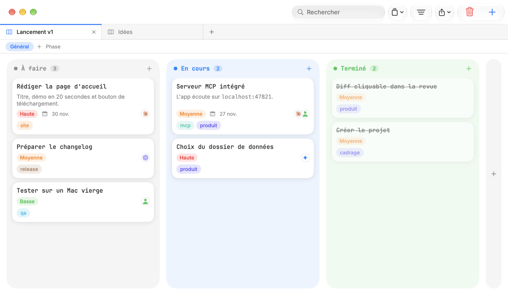

<p align="center"></p>

<h1 align="center">Kanba</h1>

<p align="center">A fast, native macOS kanban board — that your AI assistant can use too, with you approving every change.</p>

[](https://m8ven.ai/mcp/perretwilliam-kanba-92amp2?s=readme)



## Features

- **Native SwiftUI** app for macOS 26+: tabs, drag & drop, search, filters, tags, priorities and due dates.
- **Multiple boards** with custom columns and colors, plus ready-made **templates**. Delete them all and you get a welcome page.
- **Manual card order**: drag cards to rank them within a column (top = do first). AI clients read and set the order too (`position`, `reorder_cards`).
- **Phases**: split a board into sub-boards (e.g. the phases of a project), each with its own columns and cards.
- **Import** a board from JSON; **export** it as JSON, CSV (opens in Excel) or Markdown.
- **Plain JSON storage** in a folder you choose (Projets menu → *Dossier des données…*; default `~/Library/Application Support/Kanban`). If the folder already holds a `boards.json`, it is loaded; otherwise your boards are copied there. The app watches the folder and the file, so manual edits, scripts, a synced or dropped-in `boards.json` are picked up live.
- **AI-ready via MCP**: Kanba runs a local MCP server (nothing else to install), so Claude, Codex, Cursor, Gemini… can read your boards and propose changes. Assign cards to AIs (several allowed) with the model and effort level.
- **Review before apply**: AI edits are never written directly. They arrive as a git-diff-like proposal that you accept all at once or change by change; click a change to open its full before/after in a side panel.
- Toasts tell you what happened, with the logo of whoever did it (you or the AI).


> The app UI is currently in French.

## Install

Download the latest `Kanba-X.Y.Z.zip` from [Releases](https://github.com/PerretWilliam/kanba/releases), or build it yourself (macOS 26+, Xcode command line tools, Swift 6):

```bash
git clone https://github.com/PerretWilliam/kanba.git
cd kanba
./build.sh
open Kanba.app
```

## Use it with an AI (MCP)

```bash
npx -y add-mcp http://localhost:47821/mcp -g
```

(or, for Claude Code only: `claude mcp add --scope user --transport http kanban http://localhost:47821/mcp`). The server lives inside the app, on this machine only (`localhost`): Kanba must be running.

Then ask your assistant things like *"add a high-priority card about the release to my board"*. The change appears in Kanba as **N to review**; open it, tick what you want, and apply.

Available tools: `get_boards`, `add_card`, `update_card`, `reorder_cards`, `delete_card`, `clear_last_column`, `add_column`, `update_column`, `delete_column`, `add_board`, `update_board`, `select_board`, `set_filter`, `delete_board`, `export_board`, `import_board`.

How it works: tools build a proposal (the base state plus the proposed state) in memory. The app diffs the two by entity id, so edits you make in the meantime are preserved; click a change to see it in detail. Only `select_board` and `set_filter` (what is on screen) are applied immediately.

## Project layout

```
Sources/Kanban/   SwiftUI app (Model, Views, Components, Support)
tools/make-icon.swift  regenerates Icon.icns
build.sh          builds Kanba.app (version = the VERSION file)
```

See [CLAUDE.md](CLAUDE.md) for the data format.

## Contributing

Issues and pull requests are welcome — see [CONTRIBUTING.md](CONTRIBUTING.md).

## License

[MIT](LICENSE). Bundled fonts: [Inter](https://rsms.me/inter/) and [JetBrains Mono](https://www.jetbrains.com/lp/mono/), both under the SIL Open Font License.

## Releases & tests

Releases are published automatically when the `VERSION` file changes on `main` (ad-hoc signed app: right-click → Open the first time). See [CONTRIBUTING.md](CONTRIBUTING.md) for `just test` / `just cover` (100% line coverage of the logic layer, MCP server included).

AI logos are from [Simple Icons](https://simpleicons.org) (CC0); the marks belong to their owners and only identify the AI assigned to a card.
