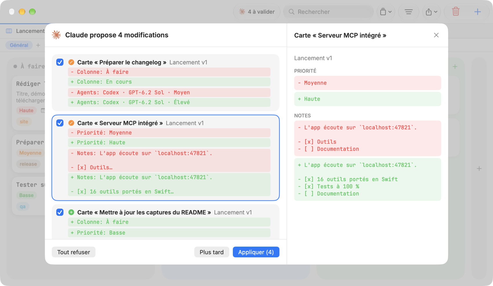

<p align="center"></p>

<h1 align="center">Kanba</h1>

<p align="center">A fast, native macOS kanban board — that your AI assistant can use too, with you approving every change.</p>


## Features

- **Native SwiftUI** app for macOS 26+: tabs, drag & drop, search, filters, tags, priorities and due dates.
- **Multiple boards** with custom columns and colors, plus ready-made **templates**. Delete them all and you get a welcome page.
- **Import** a board from JSON; **export** it as JSON, CSV (opens in Excel) or Markdown.
- **Plain JSON storage** in `~/Library/Application Support/Kanban/boards.json`; the app reloads it live, so manual edits and scripts just work.
- **AI-ready via MCP**: a tiny stdlib-only Python server lets Claude (or any MCP client) read and edit your boards.
- **Review before apply**: AI edits are never written directly. They arrive as a git-diff-like proposal that you accept all at once or change by change.
- Toasts tell you what happened, with the logo of whoever did it (you or the AI).



> The app UI is currently in French.

## Install

Requirements: macOS 26+, Xcode command line tools (Swift 6).

```bash
git clone https://github.com/PerretWilliam/kanba.git
cd kanba
./build.sh
open Kanba.app
```

## Use it with an AI (MCP)

```bash
claude mcp add --scope user kanban -- python3 "$PWD/tools/mcp.py"
```

Then ask your assistant things like *"add a high-priority card about the release to my board"*. The change appears in Kanba as **N to review**; open it, tick what you want, and apply.

Available tools: `get_boards`, `add_card`, `update_card`, `delete_card`, `clear_last_column`, `add_column`, `update_column`, `delete_column`, `add_board`, `update_board`, `select_board`, `delete_board`, `export_board`, `import_board`.

How it works: tools write a `proposal.json` (the base state plus the proposed state) next to `boards.json`. The app diffs the two by entity id, so edits you make in the meantime are preserved. Only `select_board` is applied immediately.

## Project layout

```
Sources/Kanban/   SwiftUI app (Model, Views, Components, Support)
tools/mcp.py      MCP server (Python 3, stdlib only)
tools/make-icon.swift  regenerates Icon.icns
build.sh          builds Kanba.app
```

See [CLAUDE.md](CLAUDE.md) for the data format.

## Contributing

Issues and pull requests are welcome — see [CONTRIBUTING.md](CONTRIBUTING.md).

## License

[MIT](LICENSE). Bundled fonts: [Inter](https://rsms.me/inter/) and [JetBrains Mono](https://www.jetbrains.com/lp/mono/), both under the SIL Open Font License.
